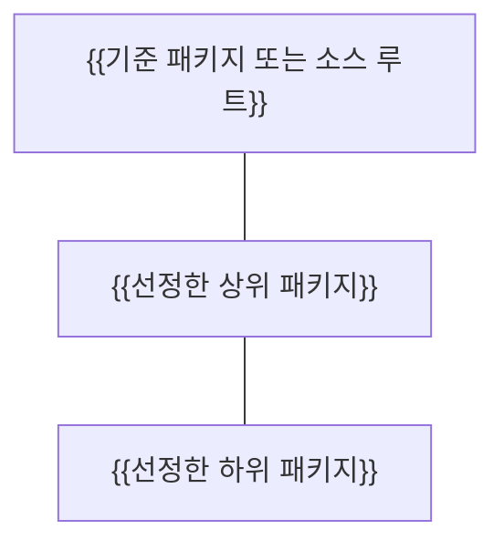

# 아키텍처

적용 MVP: {{버전}}

## 기술스택

| 역할 | 선택 기술·버전 제약 | 프로젝트 내 버전 선언 위치 | 지원 조건·선정 근거 |
|---|---|---|---|
| {{언어·런타임·프레임워크·빌드 도구와 필요한 직접 의존성}} | {{프로젝트가 요구하는 버전 범위 또는 고정값}} | {{빌드·manifest·lock·Wrapper의 상대 경로와 선언 항목. 간접 관리나 외부 서비스면 관리 주체}} | {{필수 호환 조건과 공식 근거. 벤더·패치까지 고정하면 그 필요성도 명시}} |

{{로컬에서 발견한 배포판·패치 버전을 프로젝트의 필수 제약으로 자동 채택하지 않는다. 사용자 요구·호환성·재현성에 필요한 고정 수준만 정하고, 선언 도구가 표현하는 범위와 일치시킨다. 도구가 표현하지 못하는 필수 제약은 별도 확인 방법을 정한다.}}

## 프로젝트 초기화

{{새 골격 생성이 필요한 대상만 명세한다. 기존 프로젝트는 현재 빌드·진입점과 필요한 변경만 적는다. 초기 파일 목록·Git 유무·설치 여부·검사 경위를 기록하지 않는다.}}

| 항목 | 확정 내용 |
|---|---|
| 생성 방식·기준 | {{공식 생성기·스타터·최소 예제의 URL, 도구 버전·고정 ref 또는 서비스의 고정 옵션. 기술스택 표의 근거는 반복하지 않음}} |
| 프로젝트 식별자 | {{프로젝트·모듈·기본 패키지 등 필요한 식별자}} |
| 입력 옵션 | {{언어·런타임·프레임워크·빌드 도구·패키징·의존성 선택값. 이미 정의한 버전과 이유를 별도 표로 복제하지 않음}} |
| 생성 위치·병합 | {{프로젝트 기준 작업 위치, 생성 대상, 기존 파일 보존·병합 방법}} |

{{OS/셸·상대 작업 위치와 재현 가능한 생성 명령을 한 번만 작성한다. PATH·환경변수·Wrapper를 사용한다. 주요 빌드·진입점·소스·리소스·테스트 경로와 생성 후 필요한 조정만 적고, 아래 역할 표와 같은 경로 트리를 반복하지 않는다.}}

## 실행 구성

{{현재 범위에 필요한 서비스·프로세스·실행 모드만 정의한다. 환경변수·설정 키·기본값·허용 조건은 하나의 표에 모으고 다른 절에 재서술하지 않는다. 비밀값과 개인 PC 경로는 넣지 않는다.}}

{{필요한 DB 준비·스키마 적용·서버 실행·파일 명령을 실행 위치와 함께 작성한다. 스키마 본문·입력 JSON·API 응답 예시는 소유 문서에서만 정의한다. 빌드·테스트·포맷·린트 등의 검사 명령과 AC 본문은 이 절에 복사하지 않는다.}}

## 시스템과 데이터 흐름

{{실행 단위·데이터 소유·외부 연결·접근 경계와 현재 요청의 처리 흐름을 기록한다. 저장·입력 제약과 HTTP 코드·응답 필드는 반복하지 않는다. 도식과 본문이 같은 흐름을 설명하면 하나만 사용하고, 구현 위치는 아래 역할 표에만 둔다.}}

## 패키지 구조와 책임

선정 구조: {{실행 단위·모듈·내부 배치 기준. ADR이 있으면 해당 식별자로 이유를 참조하고 대안·절충을 반복하지 않는다. ADR이 없으면 선정에 필요한 제약을 한 번만 짧게 설명한다}}.

### 패키지 계층

{{선정한 실제 패키지·디렉터리 계층을 Mermaid로 작성한다. 아래 골격을 현재 범위의 분기로 교체·확장한다. 연결선은 포함 관계이며 호출·의존 방향이 아니다. 예시의 기능별·계층별 배치를 기본값으로 삼거나 “필요 시” 후보·미래 폴더를 넣지 않는다. 파일 목록·책임·REQ·테스트는 도식에 복사하지 않는다.}}

### 역할과 구현 위치

| 모듈/역할·영문 식별자 | 담당 요구사항 | 기준 패키지·파일 | 책임·테스트 위치 |
|---|---|---|---|
| {{현재 범위의 모듈/역할}} | {{REQ ID}} | {{계층도의 패키지와 그 기준 파일 상대 경로}} | {{역할과 테스트 경로}} |

{{표에는 역할·요구사항·구체 파일과 테스트 위치만 추가한다. 같은 계층을 ASCII 트리나 본문으로 다시 나열하지 않는다. 생성기 관례·프레임워크 필수 경로·프로젝트 선택을 구분하고 진입점과 스캔·라우팅의 연결이 필요하면 명시한다.}}

## 의존 방향과 불변조건

{{허용 호출 방향과 접근 경계를 한 곳에 정의한다. 시스템 흐름이나 역할 표에서 이미 설명한 내용은 반복하지 않고, 데이터 모델의 저장 불변조건·OpenAPI의 오류 계약도 복사하지 않는다.}}
